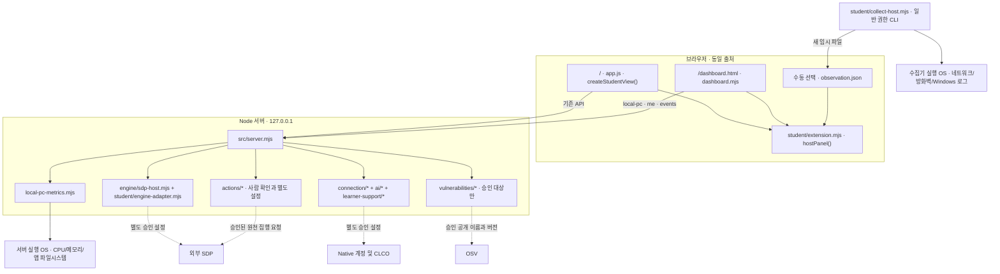
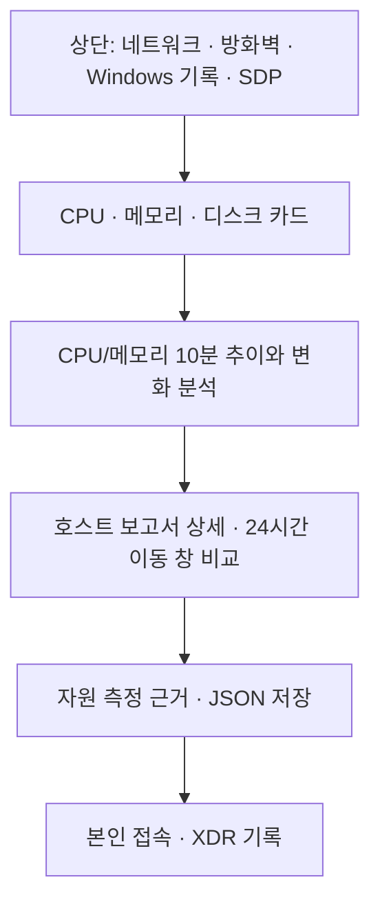

# Claire 구성과 신뢰 경계

현재 코드의 실행 경로를 설명합니다. 원격 운영 성공이나 공식 평가의 구성도가 아닙니다.

## 로컬 데이터 흐름

실선은 코드에 있는 호출·파일 전달 경로이고 점선은 별도 설정·권한이 필요한 외부 경로입니다. 파일 선택은 HTTP 수집 요청이 아니며 CLI가 서버에서 자동 실행되지 않습니다. 실제 PC 자원·선택 파일·SDP·DEMO는 동일한 출처로 합치지 않습니다.

## 책임

| 소스 | 책임 |
|---|---|
| [server.mjs](../src/server.mjs) | 루프백 HTTP, 요청·원천 응답·출처 검증, 정적 파일 허용 목록 |
| [extension.mjs](../student/extension.mjs) | 기존 학생 렌더링 훅, 호스트 파일 검증·표시·비교·집계 저장 |
| [dashboard.mjs](../public/dashboard.mjs) | 학생 호스트 패널 재사용, 자원/SDP 비동기 조회와 화면 상태 |
| [collect-host.mjs](../student/collect-host.mjs) | 네트워크·방화벽·Windows 로그의 수동 보고서 생성 |
| [local-pc-metrics.mjs](../src/local-pc-metrics.mjs) | CPU 두 표본, 메모리 total/free, 앱 파일시스템 statfs |
| [engine-adapter.mjs](../student/engine-adapter.mjs) | 실제 호스트가 제공하는 기능만 전달 |
| [ai/README.md](../src/ai/README.md) | 승인된 AI 설명/학습지원 계약 |
| [actions/README.md](../src/actions/README.md) | 별도 집행 요청·결과 원장 계약 |

## 네 가지 출처

**파일 보고서**는 사용자가 선택한 서명되지 않은 자료입니다. **PC API**는 앱 서버 실행 OS의 관측입니다. 둘이 같은 장치임을 자동으로 증명하지 않습니다. **SDP**의 신원·정책·기록은 별도 원천 검증 대상이고, **DEMO**는 합성 자료입니다.

계정 연결·모델 목록 확인·AI 추론·실제 조치 효과도 별개의 증거입니다. 서버의 configured/connected 표시를 모든 단계 성공으로 확장하지 않습니다. 실행 OS와 브라우저의 표시 시간대, 이벤트 발생 시각과 조회 시각을 구분합니다.

## 보존·플랫폼·외부 통신

기본 실행은 일반 권한이며 방화벽 설정을 수정하지 않습니다. 단, 명시적으로 구성된 별도 조치 모듈은 원천 집행 요청과 자기 원장을 쓸 수 있으므로 **앱 전체가 어떤 조건에서도 읽기만 한다고 표현하지 않습니다**. 이번 호스트 관측과 문서 작업에는 그 경로를 사용하지 않습니다.

macOS/Linux도 기본 앱·자원·해당 OS 수집 경로가 있습니다. Windows Native 호스트·자격 보관 경로까지 이식됐다고 주장하지 않습니다. 공급사 원본 키나 사용자 비밀은 브라우저·문서·Git에 넣지 않습니다. OSV·SDP·AI는 각 승인/설정 경로를 통해서만 조건부 외부 통신합니다.

루트 `api/`·`src/`는 기존 방어전 서비스입니다. `on-client/src/`와 같은 서버가 아닙니다. Workbench는 편집 도구, ALEPH는 외부 교육 운영 서비스이며 이 앱을 실행하는 로컬 서버가 아닙니다.

## 통합 화면 배치

배치의 정본은 [dashboard.html](../public/dashboard.html)이며 위 화살표는 화면 읽기 순서이지 탐지·집행의 인과관계가 아닙니다.

CPU 사용률의 Windows IRQ 중복 합산을 제외하며, CPU 관측 구간과 단조 시계가 불일치하면 확인 불가로 처리합니다. 메모리는 OS가 제공하는 total/free 바이트에 기반합니다. 모든 PC 측정은 실행 OS의 관측치이지 보안 판정이나 SDP 연결 증거가 아닙니다.

대시보드의 PC 자원 조회는 동일 출처의 `GET /api/local-pc`를 사용하며, 호스트 보고서는 로컬 파일로 읽습니다.
