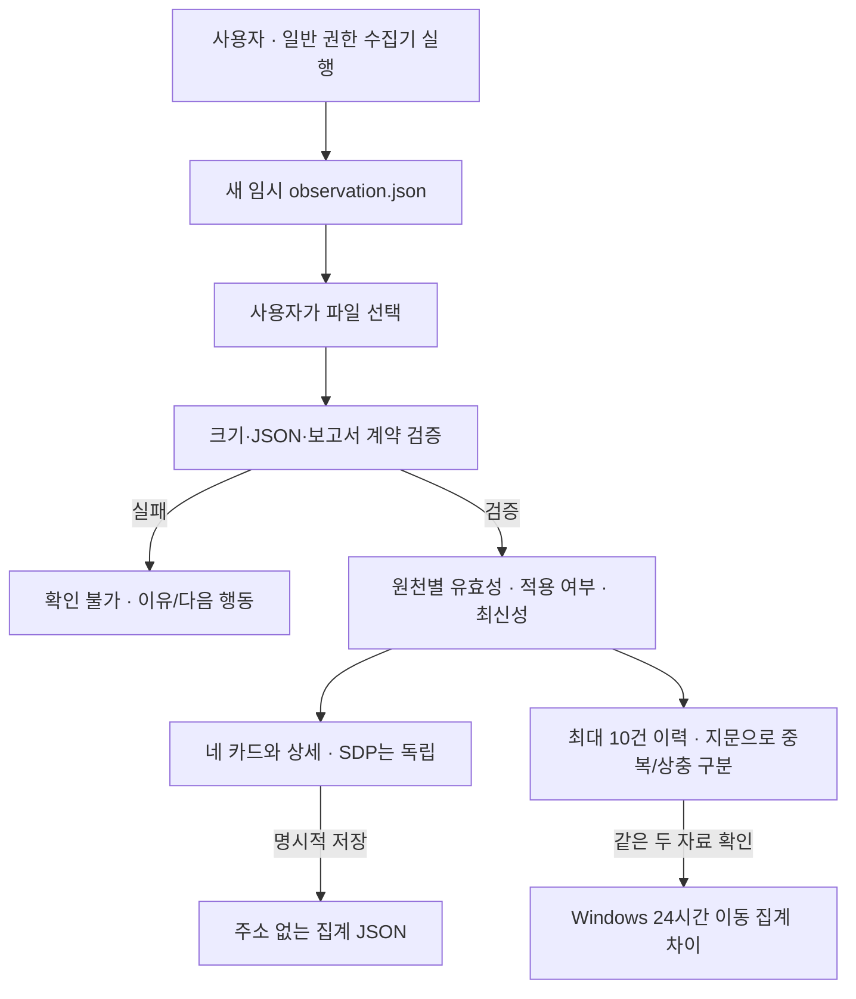

# 학생 영역의 호스트 관측

근거: [수집기](collect-host.mjs), [학생 표시](extension.mjs), [통합 화면](../public/dashboard.mjs). 기존 네트워크·방화벽·Windows 기록 수집과 네 카드 표시를 재사용합니다. 별도 수집 서버·설정 변경·권한 상승을 추가하지 않습니다.

## 수집과 표시

기존 `on-client` 폴더의 일반 권한 터미널에서 실행합니다.

```sh
node student/collect-host.mjs
```

새 임시 폴더의 `observation.json` 경로가 출력됩니다. 기존 `/`의 학생 상태 영역 또는 `/dashboard.html`의 **다시 조회 · 보고서 선택**에서 지정합니다. 이 버튼은 JSON만 읽고 OS 명령을 실행하지 않습니다. 새 관측에는 수집기를 다시 실행한 새 파일이 필요합니다.

원본은 `claire.host-observation.v1`, `local-node-runtime`, `user-generated-local-file-not-authenticated` 계약입니다. 사용자가 선택한 **서명되지 않은 파일**이므로 원본 진위나 동일 PC를 인증하지 않습니다. 내부 IP·DNS가 있을 수 있으니 공개 저장소·캡처에 넣지 않습니다. POSIX 파일 생성은 0600 모드를 요청하고 Windows ACL은 환경을 따릅니다.

## OS별 실제 조회 범위

| 항목 | Windows | macOS | Linux |
|---|---|---|---|
| 네트워크 | `os.networkInterfaces`와 `dns.getServers` | 동일 | 동일 |
| 방화벽 | `Get-NetFirewallProfile -PolicyStore ActiveStore`의 프로필 설정 | `socketfilterfw --getglobalstate`의 Application Firewall | 고정된 firewalld/UFW 상태 조회 |
| OS 기록 | Get-WinEvent의 System/Application, Level 2 오류·3 경고 | Windows 전용·해당 없음 | Windows 전용·해당 없음 |

네트워크는 Node 실행 환경의 IP·인터페이스·루프백과 DNS resolver 정보입니다. 기본 게이트웨이·전체 라우팅·모든 어댑터 DNS·MAC·호스트 이름·패킷을 수집하지 않습니다. Windows 방화벽의 ActiveStore는 현재 활성 프로필·타사 방화벽·모든 규칙 적용을 보증하지 않습니다. Domain/Private/Public 세 프로필 모두 확인되고 Enabled가 명확할 때 해당 조회 범위 완료입니다. 누락·미설정(NotConfigured)은 일부 조회이며 Enabled 미설정은 null/확인 불가로 표시합니다. 구형 v1 파일도 누락 프로필은 일부 조회로 낮추지만 이미 불리언으로 변환된 과거 값은 소급 인증할 수 없으므로 새 보고서를 사용하세요. Linux는 실제 조회된 도구만 표시하고 실패한 도구·허용된 사유 코드를 따로 표시합니다. 예전 보고서에 도구별 사유가 없으면 임의로 채우지 않습니다. macOS pf 및 Linux nftables/iptables 전체 상태도 이 관측 범위가 아닙니다.

System/Application은 각각 최근 24시간의 최대 2,001건을 읽어 2,000건 초과를 감지합니다. 초과하면 정확한 건수를 null로 표시합니다. 정상적으로 일치 사건이 없는 0건과 권한·도구·시간 초과의 확인 불가는 구별합니다. **이 건수는 침해나 공격 탐지 결과가 아닙니다.**

수집 명령은 코드에 고정되어 있으며 관리자 실행·sudo/runas·방화벽 변경·서비스 시작/중지·로그 삭제·공격 재현을 하지 않습니다. 한 명령의 제한 시간은 8초, 출력 상한은 64 KiB입니다. 수집 보고서 상한은 128 KiB입니다.

## 시간·상태·추이

- `producedAt`: 수집 보고서 생성 시각.
- 원천 `measuredAt`: 구현상 조회 기준 시각. 방화벽 명령 직전 또는 이벤트 집계 종료 기준이며 명령 완료 시각과 같다고 가정하지 않습니다.
- `windowStart`/`windowEnd`: Windows 이벤트의 24시간 집계 구간.
- `loadedAt`: 브라우저의 파일 검증 시각. OS 재측정 시각이 아닙니다.

현재 품질 판정은 보고서와 각 조회 원천의 **15분 경과·미래 5초 초과**를 구별합니다. 화면은 15초 주기로 시간 상태 변화를 확인합니다. 브라우저 타이머 제한으로 화면 반영이 더 늦어질 수 있습니다. 파일 읽기는 10초 제한, 이력은 현재 탭 메모리 최대 10건입니다. 정규화한 보고서의 SHA-256 지문은 **동일 시각 재선택의 중복/상충 구분용**이며 기기 서명이나 수집기 진위 증명이 아닙니다. 같은 시각에 다른 지문이 있으면 해당 시점의 비교 수치를 제거하고 상충을 표시합니다. Web Crypto를 사용할 수 없으면 동일 시각 재선택을 보수적으로 상충으로 취급합니다. [현재 한계](../../docs/CURRENT_LIMITATIONS.md)를 참고하세요.

Windows 비교는 사용자의 동일 PC·실행 환경 확인을 **두 보고서의 시각·지문 조합에 한정**하여 24시간 합계 차이를 보여 줍니다. 이는 그 사이 새로 발생한 사건 수가 아닙니다. 서명되지 않은 자료이므로 확인 체크가 기기 인증을 대신하지 않습니다.

## 화면·다운로드 경계

`hostPanel(state, mode)`의 상단 네 카드는 네트워크·방화벽·Windows 기록·SDP입니다. `state.hostRedraw`와 `[data-host-report-details]`를 통합 화면에서 재사용합니다. 읽는 중 버튼 비활성화·대기 안내, 오류 이유·다음 행동, 기본 상세 펼치기 조작이 있습니다. 두 화면의 초점·상세 상태는 각각 검증해야 합니다.

주소·식별자 제외 집계 JSON은 사용자가 직접 저장하며 `claire.host-aggregate-evidence.v1`에 개수·시각·원천·조회 상태, 보고서 및 원천별 최신성, 실행 OS, Windows 집계 구간을 넣습니다. 오래된 수치도 역사적 자료로 유지하되 sourceStatus와 개별 measurement의 freshness를 함께 읽어야 합니다. 누락 또는 검증 불가 원천은 현재 관측 성공으로 합산하지 않습니다. IP·DNS 주소·인터페이스명·계정·SDP 사건은 제외합니다. `firewallBackends`의 숫자와 단위는 Windows `profiles`, Linux `observed-tools`, macOS `application-firewall`로 구분합니다. 세 플랫폼의 숫자를 같은 방화벽 규칙·정책 수로 비교하지 않습니다.

SDP 미연결·DEMO·어댑터 구성과 PC 관측은 독립입니다. 실제 연결과 권한은 기존 제공 화면의 원천 응답에서 확인합니다. 데이터가 없으면 예시 숫자를 넣지 않습니다.

[앱 실행](../docs/STUDENT_LAUNCH_GUIDE.md) · [전체 확인 순서](../docs/STUDENT_RUNBOOK.md)

## 파일 처리 흐름



이 그림은 파일의 내용 검증 흐름입니다. 서명 검증·기기 인증·침해 탐지나 원격 전송 절차를 의미하지 않습니다.

동일 생성 시각에 내용이 충돌한 미서명 보고서는 해당 시각의 기록을 격리하고 현재 카드·집계 저장·비교에서 제외합니다. 새 생성 시각의 보고서를 선택해야 다시 표시할 수 있습니다.

## 원천별 부분 실패와 비교 기준 (2026-11-24)

새 보고서의 `network.parts.interfaces`와 `network.parts.dns`는 각각 상태, 출처, 조회 기준 시각, 사유를 보존합니다. 기존 v1 보고서는 계속 읽되, 이 필드가 없으면 과거에 분리하지 않았던 실패 이유를 추정하지 않습니다. 한 원천만 실패하면 다른 원천의 검증된 값을 유지하고, 실패한 원천의 집계값은 null입니다. 성공적으로 읽은 빈 목록은 0개이며 실패한 빈 배열은 0개가 아닙니다. 시각이 오래됐거나 미래인 원천은 현재 상태를 인증하지 않습니다.

보고서 생성 시각은 파일 식별과 중복·상충 판정에만 사용합니다. Windows 추이 비교에는 실제 `windowStart`/`windowEnd`를 보존합니다. 서로 다른 생성 시각이어도 같은 집계 창을 다시 조회한 자료 또는 집계 종료 시각이 역순인 자료는 이동 집계 차이로 계산하지 않습니다. 이 건수는 현재 보존된 System/Application 기록의 필터 결과이며, 로그 회전으로 사라진 기록이나 침해 탐지를 뜻하지 않습니다.

선택한 로컬 JSON은 실제 수집 여부·원본 진위가 미인증입니다. 앱이 실패 시 예제 값을 생성하지 않는 것과 파일의 내용이 실측인지 여부는 구별합니다. 주소·식별자를 제외한 집계도 정확한 시각·건수·OS를 포함하므로 익명성을 보증하지 않습니다. 원본 임시 보고서에는 내부 네트워크 주소가 있을 수 있습니다. 사용자가 필요한 자료만 개인 저장 위치에 보관하고, 필요 없어진 임시 파일은 경로를 확인한 뒤 직접 정리하세요. 앱이 기존 파일을 자동으로 삭제하지는 않습니다.
