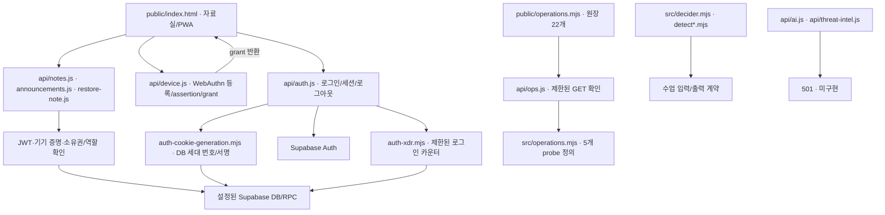

# 루트 방어전과 Claire 로컬 앱

## 기존 루트 서비스

화살표는 소스의 호출/권한 관계를 설명합니다. WebAuthn 기기 증명과 JWT/소유권 검사는 자료 요청에서 함께 검증되며, 도식이 DB 마이그레이션이나 공개 배포를 확인한 결과는 아닙니다. 작전실 22개 원장 항목은 22개 실제 검증 통과를 의미하지 않으며 자동 실행 가능한 확인은 5개 정의로 제한됩니다. 이 도구를 현재 Claire 관제 검증을 위해 실행하지 않습니다.

근거: [auth](../api/auth.js), [device](../api/device.js), [notes](../api/notes.js), [ops](../api/ops.js), [operations](../src/operations.mjs), [판정](../src/decider.mjs), [배포 설정](../vercel.json).

## 별도 로컬 앱

[Claire 로컬 구성도](../on-client/docs/STUDENT_ARCHITECTURE.md)는 `on-client/`의 동일 출처 Node 서버, 수동 파일 수집기, 자원 API, 조건부 SDP/AI의 별도 경로를 설명합니다. 루트 서버 함수·정적 PWA와 동일한 서버가 아닙니다. 로컬 앱은 기존 폴더에서 일반 권한으로 실행하며 루트 정적 미리보기, 포장, 배포는 필요하지 않습니다.
